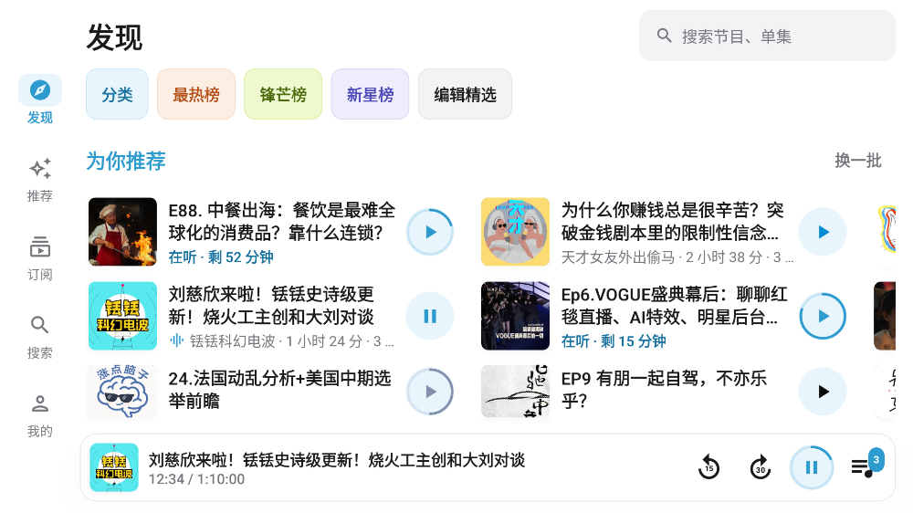

# 小宇宙车机版

为比亚迪 DiLink 车机（优先海豹 08 EV）适配的非官方小宇宙 FM 客户端

## 功能

- 扫码登录，与手机端同一账号，token 自动续期
- 发现 / 推荐 / 订阅 / 搜索 / 我的，与官方 App 一致的导航
- 推荐：综合 + 19 个官方分类，「为你推荐」换一批
- 订阅：「未听 + 在听」单集流，节目网格按最新更新排序
- 搜索：综合 / 节目 / 单集，关键词高亮
- 播放：后台播放、倍速、后退 15 / 前进 30 秒、定时关闭、播放列表、进度与手机同步
- 方向盘按键：上一曲 / 下一曲 = 后退 15 / 前进 30 秒
- 车机布局：横屏侧边导航，窄屏（分屏、竖屏）自动切底部导航
- 浅色 / 深色 / 跟随系统，5 档显示大小，全程过渡动画
- 应用内更新：国内走 Gitee，失败自动换 GitHub，下载后校验 SHA-256

## 安装

1. 下载 `xyzcar-<版本>.apk`：国内用 [Gitee 发行版](https://gitee.com/xiayuryan/xyzcar/releases)，或 [GitHub Releases](https://github.com/xiayu1996/xyzcar/releases)
2. 任选一种方式装到车机：
   - **U 盘**：APK 放 U 盘根目录，用车机文件管理器打开安装
   - **ADB**：车机开启调试后执行 `adb install -r xyzcar-<版本>.apk`
3. 打开 App，用手机小宇宙扫码并确认登录

## 使用

| 操作 | 说明 |
|---|---|
| 展开播放页 | 点底部迷你播放条 |
| 加入播放列表 | 单集右侧按钮；当前单集播完自动接续 |
| 定时关闭 | 播放页月亮按钮，15 → 30 → 60 分钟 → 关闭 |
| 跳转时间点 | 点单集简介里的时间戳（如 `12:05`） |
| 外观 / 显示大小 | 「我的」页 |
| 车机信息 | 我的 → 车机信息（排查分屏、语音问题） |
| 检查更新 | 我的 → 检查更新；比亚迪车机不允许应用自行安装时，安装包会存到「下载/xyzcar/」和 U 盘，点击打开车机文件管理安装 |

已知限制：无离线下载；小迪语音暂不能打开本应用；能否进入分屏取决于车机系统。

开发、构建、发布见 [docs/development.md](docs/development.md)。

## 致谢

- [ultrazg/xyz](https://github.com/ultrazg/xyz)：小宇宙接口定义参考
- [jackwener/OpenCLI](https://github.com/jackwener/OpenCLI)、[MosesHe/xiaoyuzhoufm-mcp](https://github.com/MosesHe/xiaoyuzhoufm-mcp)、[shiquda/xyz-dl](https://github.com/shiquda/xyz-dl)：token 刷新策略参考
- [AndyShaman/BYDMate](https://github.com/AndyShaman/BYDMate)：比亚迪车机分屏适配思路参考

## 许可

[PolyForm Noncommercial 1.0.0](LICENSE)，禁止任何商业用途。

非官方客户端，仅供个人学习交流，与小宇宙官方无关；应用图标及节目内容版权归小宇宙及原作者所有。
